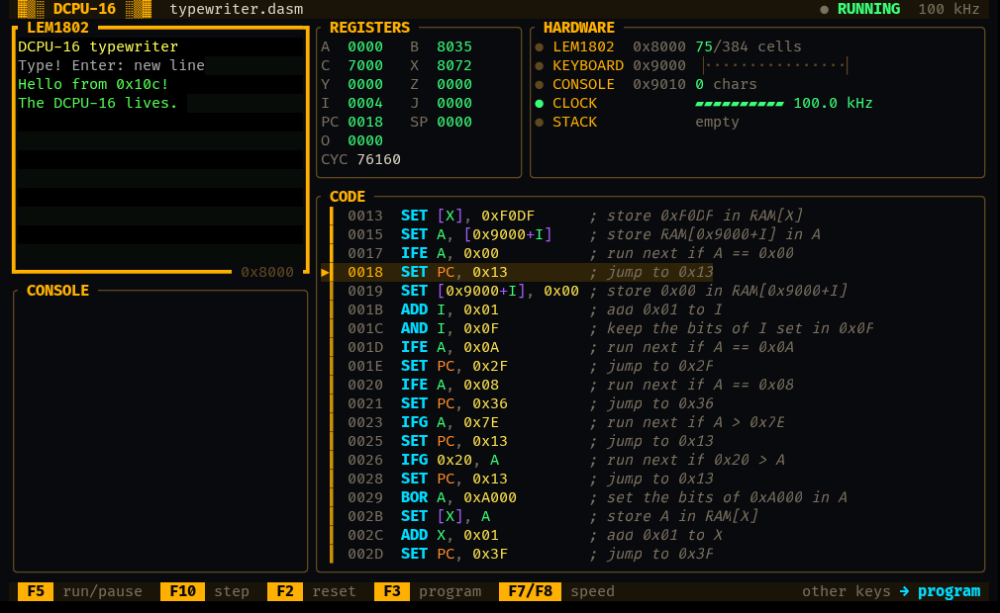

# DCPU-16 Emulator and Assembler

An emulator for the DCPU-16 16-bit processor described for the 
[0x10<sup>c</sup>] video game.

The [DCPU-16 Specification](docs/specification.txt) is no longer available on the
original website (as is the entire website) but still can be obtained from the [Wayback Machine].

An implementation of a DCPU-16 assembler is also provided in this repo and is built by default through 
the crate's `assembler` feature. It has no dependencies and reports syntax errors, undefined or duplicate
labels, out-of-range literals and programs longer than the emulator accepts as an `AssembleError` with the line
and column of the problem.

[](https://sunsided.github.io/dcpu-16/)

The [terminal UI](#terminal-ui) above runs programs with a screen, keyboard and console, and also
[runs in the browser](https://sunsided.github.io/dcpu-16/).

## Example usage

See [examples/sample.rs] for a commented example application. Here's a sneak peek:

```rust
use dcpu16::{Register, DCPU16};

fn main() {
    let program = [
        0x7c01, 0x0030, 0x7de1, 0x1000, 0x0020, 0x7803, 0x1000, 0xc00d, 0x7dc1, 0x001a, 0xa861,
        0x7c01, 0x2000, 0x2161, 0x2000, 0x8463, 0x806d, 0x7dc1, 0x000d, 0x9031, 0x7c10, 0x0018,
        0x7dc1, 0x001a, 0x9037, 0x61c1, 0x7dc1, 0x001a, 0x0000, 0x0000, 0x0000, 0x0000,
    ];

    let mut cpu = DCPU16::new(&program);

    // Use cpu.step() to step through each instruction.
    // cpu.run() executes until a crash loop is detected.
    cpu.run();

    assert_eq!(cpu.program_counter, 0x001A);
    assert_eq!(cpu.register(Register::A), 0x2000);
    assert_eq!(cpu.register(Register::X), 0x40);
    
    let ram = cpu.ram();
    assert_eq!(ram[0x1000], 0x20);
}
```

### Running the emulation example

The example program can be started with

```console
RUST_LOG=dcpu16=trace cargo run --example sample
```

It executes the program given in the [DCPU-16 Specification](docs/specification.txt):

```asm
; Try some basic stuff
              SET A, 0x30              ; 7c01 0030
              SET [0x1000], 0x20       ; 7de1 1000 0020
              SUB A, [0x1000]          ; 7803 1000
              IFN A, 0x10              ; c00d
                 SET PC, crash         ; 7dc1 001a

; Do a loopy thing
              SET I, 10                ; a861
              SET A, 0x2000            ; 7c01 2000
:loop         SET [0x2000+I], [A]      ; 2161 2000
              SUB I, 1                 ; 8463
              IFN I, 0                 ; 806d
                 SET PC, loop          ; 7dc1 000d

; Call a subroutine
              SET X, 0x4               ; 9031
              JSR testsub              ; 7c10 0018
              SET PC, crash            ; 7dc1 001a

:testsub      SHL X, 4                 ; 9037
              SET PC, POP              ; 61c1

; Hang forever. X should now be 0x40 if everything went right.
:crash        SET PC, crash            ; 7dc1 001a
```

The above program can be assembled into to the following bytecode:

```hexdump
0000: 7c01 0030 7de1 1000 0020 7803 1000 c00d
0008: 7dc1 001a a861 7c01 2000 2161 2000 8463
0010: 806d 7dc1 000d 9031 7c10 0018 7dc1 001a
0018: 9037 61c1 7dc1 001a 0000 0000 0000 0000
```

When executing the bytecode instructions, the program output looks like this:

```
 INFO dcpu16: Loaded 32 words of program data
DEBUG dcpu16: Registers: A=0000 B=0000 C=0000 X=0000 Y=0000 Z=0000 I=0000 J=0000 PC⁎=0000 SP=0000 O=0000
DEBUG dcpu16: EXEC 0000: 7c01 0030 ; SET A, 0x30 ("A <- 0x30")
DEBUG dcpu16: Registers: A=0030 B=0000 C=0000 X=0000 Y=0000 Z=0000 I=0000 J=0000 PC⁎=0002 SP=0000 O=0000
DEBUG dcpu16: EXEC 0002: 7de1 1000 0020 ; SET [0x1000], 0x20 ("RAM[0x1000] <- 0x20")
DEBUG dcpu16: Registers: A=0030 B=0000 C=0000 X=0000 Y=0000 Z=0000 I=0000 J=0000 PC⁎=0005 SP=0000 O=0000
DEBUG dcpu16: EXEC 0005: 7803 1000 ; SUB A, [0x1000] ("A <- A - RAM[0x1000]")
DEBUG dcpu16: Registers: A=0010 B=0000 C=0000 X=0000 Y=0000 Z=0000 I=0000 J=0000 PC⁎=0007 SP=0000 O=0000
DEBUG dcpu16: EXEC 0007: c00d ; IFN A, 0x10 ("execute next instruction if A != 0x10")
DEBUG dcpu16: Registers: A=0010 B=0000 C=0000 X=0000 Y=0000 Z=0000 I=0000 J=0000 PC⁎=0008 SP=0000 O=0000
DEBUG dcpu16: SKIP 0008: 7dc1 001a ; SET PC, 0x1A ("PC <- 0x1A")
DEBUG dcpu16: Registers: A=0010 B=0000 C=0000 X=0000 Y=0000 Z=0000 I=0000 J=0000 PC⁎=000A SP=0000 O=0000
DEBUG dcpu16: EXEC 000A: a861 ; SET I, 0x0A ("I <- 0x0A")
DEBUG dcpu16: Registers: A=0010 B=0000 C=0000 X=0000 Y=0000 Z=0000 I=000A J=0000 PC⁎=000B SP=0000 O=0000
DEBUG dcpu16: EXEC 000B: 7c01 2000 ; SET A, 0x2000 ("A <- 0x2000")
DEBUG dcpu16: Registers: A=2000 B=0000 C=0000 X=0000 Y=0000 Z=0000 I=000A J=0000 PC⁎=000D SP=0000 O=0000
DEBUG dcpu16: EXEC 000D: 2161 2000 ; SET [0x2000+I], [A] ("RAM[0x2000 + I] <- RAM[A]")
DEBUG dcpu16: Registers: A=2000 B=0000 C=0000 X=0000 Y=0000 Z=0000 I=000A J=0000 PC⁎=000F SP=0000 O=0000
DEBUG dcpu16: EXEC 000F: 8463 ; SUB I, 0x01 ("I <- I - 0x01")
DEBUG dcpu16: Registers: A=2000 B=0000 C=0000 X=0000 Y=0000 Z=0000 I=0009 J=0000 PC⁎=0010 SP=0000 O=0000
DEBUG dcpu16: EXEC 0010: 806d ; IFN I, 0x00 ("execute next instruction if I != 0x00")
DEBUG dcpu16: Registers: A=2000 B=0000 C=0000 X=0000 Y=0000 Z=0000 I=0009 J=0000 PC⁎=0011 SP=0000 O=0000
DEBUG dcpu16: EXEC 0011: 7dc1 000d ; SET PC, 0x0D ("PC <- 0x0D")
DEBUG dcpu16: Registers: A=2000 B=0000 C=0000 X=0000 Y=0000 Z=0000 I=0009 J=0000 PC⁎=000D SP=0000 O=0000
DEBUG dcpu16: EXEC 000D: 2161 2000 ; SET [0x2000+I], [A] ("RAM[0x2000 + I] <- RAM[A]")
DEBUG dcpu16: Registers: A=2000 B=0000 C=0000 X=0000 Y=0000 Z=0000 I=0009 J=0000 PC⁎=000F SP=0000 O=0000
DEBUG dcpu16: EXEC 000F: 8463 ; SUB I, 0x01 ("I <- I - 0x01")
DEBUG dcpu16: Registers: A=2000 B=0000 C=0000 X=0000 Y=0000 Z=0000 I=0008 J=0000 PC⁎=0010 SP=0000 O=0000
DEBUG dcpu16: EXEC 0010: 806d ; IFN I, 0x00 ("execute next instruction if I != 0x00")
DEBUG dcpu16: Registers: A=2000 B=0000 C=0000 X=0000 Y=0000 Z=0000 I=0008 J=0000 PC⁎=0011 SP=0000 O=0000
DEBUG dcpu16: EXEC 0011: 7dc1 000d ; SET PC, 0x0D ("PC <- 0x0D")
DEBUG dcpu16: Registers: A=2000 B=0000 C=0000 X=0000 Y=0000 Z=0000 I=0008 J=0000 PC⁎=000D SP=0000 O=0000
... loop repeats ...
DEBUG dcpu16: EXEC 000D: 2161 2000 ; SET [0x2000+I], [A] ("RAM[0x2000 + I] <- RAM[A]")
DEBUG dcpu16: Registers: A=2000 B=0000 C=0000 X=0000 Y=0000 Z=0000 I=0001 J=0000 PC⁎=000F SP=0000 O=0000
DEBUG dcpu16: EXEC 000F: 8463 ; SUB I, 0x01 ("I <- I - 0x01")
DEBUG dcpu16: Registers: A=2000 B=0000 C=0000 X=0000 Y=0000 Z=0000 I=0000 J=0000 PC⁎=0010 SP=0000 O=0000
DEBUG dcpu16: EXEC 0010: 806d ; IFN I, 0x00 ("execute next instruction if I != 0x00")
DEBUG dcpu16: Registers: A=2000 B=0000 C=0000 X=0000 Y=0000 Z=0000 I=0000 J=0000 PC⁎=0011 SP=0000 O=0000
DEBUG dcpu16: SKIP 0011: 7dc1 000d ; SET PC, 0x0D ("PC <- 0x0D")
DEBUG dcpu16: Registers: A=2000 B=0000 C=0000 X=0000 Y=0000 Z=0000 I=0000 J=0000 PC⁎=0013 SP=0000 O=0000
DEBUG dcpu16: EXEC 0013: 9031 ; SET X, 0x04 ("X <- 0x04")
DEBUG dcpu16: Registers: A=2000 B=0000 C=0000 X=0004 Y=0000 Z=0000 I=0000 J=0000 PC⁎=0014 SP=0000 O=0000
TRACE dcpu16::instruction: Decoding non-basic instruction 7C10, opcode 01, value 1F
DEBUG dcpu16: EXEC 0014: 7c10 0018 ; JSR 0x18 ("jump to subroutine at 0x18")
DEBUG dcpu16: Registers: A=2000 B=0000 C=0000 X=0004 Y=0000 Z=0000 I=0000 J=0000 PC⁎=0018 SP=FFFF O=0000
DEBUG dcpu16: EXEC 0018: 9037 ; SHL X, 0x04 ("X <- X << 0x04")
DEBUG dcpu16: Registers: A=2000 B=0000 C=0000 X=0040 Y=0000 Z=0000 I=0000 J=0000 PC⁎=0019 SP=FFFF O=0000
DEBUG dcpu16: EXEC 0019: 61c1 ; SET PC, POP ("PC <- pop value from stack")
DEBUG dcpu16: Registers: A=2000 B=0000 C=0000 X=0040 Y=0000 Z=0000 I=0000 J=0000 PC⁎=0016 SP=0000 O=0000
DEBUG dcpu16: EXEC 0016: 7dc1 001a ; SET PC, 0x1A ("PC <- 0x1A")
DEBUG dcpu16: Registers: A=2000 B=0000 C=0000 X=0040 Y=0000 Z=0000 I=0000 J=0000 PC⁎=001A SP=0000 O=0000
DEBUG dcpu16: EXEC 001A: 7dc1 001a ; SET PC, 0x1A ("PC <- 0x1A")
 WARN dcpu16: Crash loop detected at PC=001A - terminating
```

After the execution, the `X` register contains the word `0040` as expected (by the specification).

### Running the assembly / compilation example

See [examples/assemble.rs] for a commented example application. It can be started with

```console
RUST_LOG=dcpu16=trace cargo run --example assemble
```

Here's some example code:

```rust
use dcpu16::{assemble, DCPU16};

fn main() {
    tracing_subscriber::fmt::init();

    let source = r"
        ; Try some basic stuff
                      SET A, 0x30              ; 7c01 0030
                      SET [0x1000], 0x20       ; 7de1 1000 0020
                      SUB A, [0x1000]          ; 7803 1000
                      IFN A, 0x10              ; c00d
                         SET PC, crash         ; d9c1*

        ; Do a loopy thing
                      SET I, 10                ; a861
                      SET A, 0x2000            ; 7c01 2000
        :loop         SET [0x2000+I], [A]      ; 2161 2000
                      SUB I, 1                 ; 8463
                      IFN I, 0                 ; 806d
                         SET PC, loop          ; b1c1*

        ; Call a subroutine
                      SET X, 0x4               ; 9031
                      JSR testsub              ; d010*
                      SET PC, crash            ; d9c1*

        :testsub      SHL X, 4                 ; 9037
                      SET PC, POP              ; 61c1

        ; Hang forever. X should now be 0x40 if everything went right.
        :crash        SET PC, crash            ; d9c1*
    ";

    let program = match assemble(source) {
        Ok(program) => program,
        Err(error) => {
            eprintln!("error: {error}");
            std::process::exit(1);
        }
    };

    let mut cpu = DCPU16::new(program.as_slice());
    println!("{}", cpu.hexdump_program(8));

    cpu.run();

    // The last instruction perform a crash loop by jumping to itself (SET PC, 0x0016).
    // The length of that operation is one word, hence the following assertion.
    assert_eq!(cpu.program_counter, (program.len() - 1) as u16);
}
```

Here's the hexdump of the generated program. Note that this code is shorter
than the provided original bytecode due to inlining of small constants;
for example, the `:crash SET PC, crash` instruction is rendered as `7dc1 001a`
in the original code but represented using `d9c1` in this output:

```hexdump
0000: 7C01 0030 7DE1 1000 0020 7803 1000 C00D
0008: D9C1 A861 7C01 2000 2161 2000 8463 806D
0010: B1C1 9031 D010 D9C1 9037 61C1 D9C1
```

This is the tracing output of the assembler:

```
TRACE dcpu16::assembler: 0000: Basic(Set, Static(Register(A)), Static(Literal(48))) => [7C01, 0030]
TRACE dcpu16::assembler: 0002: Basic(Set, Static(Address(4096)), Static(Literal(32))) => [7DE1, 1000, 0020]
TRACE dcpu16::assembler: 0005: Basic(Sub, Static(Register(A)), Static(Address(4096))) => [7803, 1000]
TRACE dcpu16::assembler: 0007: Basic(Ifn, Static(Register(A)), Static(Literal(16))) => [C00D]
TRACE dcpu16::assembler: 0008: Basic(Set, Static(SpecialRegister(ProgramCounter)), Label("crash")) => [D9C1]
TRACE dcpu16::assembler: 0009: Basic(Set, Static(Register(I)), Static(Literal(10))) => [A861]
TRACE dcpu16::assembler: 000A: Basic(Set, Static(Register(A)), Static(Literal(8192))) => [7C01, 2000]
TRACE dcpu16::assembler: 000C: Basic(Set, Static(AddressOffset { address: 8192, register: I }), Static(AddressFromRegister(A))) => [2161, 2000]
TRACE dcpu16::assembler: 000E: Basic(Sub, Static(Register(I)), Static(Literal(1))) => [8463]
TRACE dcpu16::assembler: 000F: Basic(Ifn, Static(Register(I)), Static(Literal(0))) => [806D]
TRACE dcpu16::assembler: 0010: Basic(Set, Static(SpecialRegister(ProgramCounter)), Label("loop")) => [B1C1]
TRACE dcpu16::assembler: 0011: Basic(Set, Static(Register(X)), Static(Literal(4))) => [9031]
TRACE dcpu16::assembler: 0012: NonBasic(Jsr, Label("testsub")) => [D010]
TRACE dcpu16::assembler: 0013: Basic(Set, Static(SpecialRegister(ProgramCounter)), Label("crash")) => [D9C1]
TRACE dcpu16::assembler: 0014: Basic(Shl, Static(Register(X)), Static(Literal(4))) => [9037]
TRACE dcpu16::assembler: 0015: Basic(Set, Static(SpecialRegister(ProgramCounter)), Static(StackOperation(Pop))) => [61C1]
TRACE dcpu16::assembler: 0016: Basic(Set, Static(SpecialRegister(ProgramCounter)), Label("crash")) => [D9C1]
TRACE dcpu16::assembler: assembled 23 words in 2 passes
```

### Assembler syntax

Each line holds an optional label definition, an optional instruction and an optional `;` comment.
Mnemonics, registers and special names (`SP`, `PC`, `O`, `PUSH`, `PEEK`, `POP`) are upper case;
label names are case-sensitive.

| Form                                 | Meaning                                                            |
|--------------------------------------|--------------------------------------------------------------------|
| `:name`                              | Defines a label at the current address                             |
| `42`, `0x2a`                         | A literal                                                          |
| `name`                               | A label's address as a literal; not allowed as the first operand  |
| `[0x1000]`, `[name]`                 | The word at an address                                             |
| `[A]`                                | The word at the address in a register                              |
| `[0x10+A]`, `[A+0x10]`, `[name+I]`   | The word at an address plus a register                             |
| `DAT 1, 0x20, name, "text"`          | Raw words; strings contribute one word per character               |

String literals support the escapes `\"`, `\\`, `\n`, `\r`, `\t` and `\0`. For example, this
copies a zero-terminated string to `0x8000`, where video memory starts by DCPU-16 1.1 convention:

```dasm
              SET I, 0
:loop         SET A, [message+I]
              IFE A, 0
                 SET PC, end
              SET [0x8000+I], A
              ADD I, 1
              SET PC, loop
:end          SET PC, end

:message      DAT "Hello, world!", 0
```

## Devices

The DCPU-16 1.1 specification defines no I/O, so the [`devices`](src/devices.rs) module follows
the memory-mapped conventions that grew around it. Devices are attached to the CPU and get access
to RAM after every instruction:

| Address           | Device                                                                    |
|-------------------|---------------------------------------------------------------------------|
| `0x8000`–`0x817f` | `screen`: 32×12 cells of `ffff bbbb B ccccccc` (colors, blink, character) |
| `0x9000`–`0x900f` | `Keyboard`: ring buffer; a non-zero word is a key, clear it to take it    |
| `0x9010`          | `Console`: write a character to print it; the word is cleared when done   |

```rust
use dcpu16::devices::{Console, Keyboard};
use dcpu16::{assemble, DCPU16};

let program = assemble(r#"
              SET I, 0
:loop         SET A, [message+I]
              IFE A, 0
                 SET PC, end
              SET [0x9010], A
              ADD I, 1
              SET PC, loop
:end          SET PC, end
:message      DAT "Hello, world!", 0
"#).unwrap();

let (keyboard, input) = Keyboard::new();
let mut cpu = DCPU16::new(&program);
cpu.attach(keyboard);
cpu.attach(Console::new(std::io::stdout()));

input.press(u16::from(b'x')); // e.g. from an input thread
while cpu.run_for(1000) {
    std::thread::sleep(std::time::Duration::from_millis(10)); // 100 kHz
}
```

The screen needs no ticking; frontends read it with `screen::cells` or `screen::text`.
`DCPU16::cycles` counts cycles as the specification defines them, which `run_for` uses to pace
execution. Try it interactively with `task run:echo`, which echoes typed lines in upper case.

## Terminal UI

The [`dcpu16-tui`](tui) crate in this repository runs programs in the terminal. It shows the
screen, the console output, the registers and the code around the program counter, and sends
typed keys to the program:

```console
task run:tui PROGRAM=tui/programs/typewriter.dasm
```

The same interface also runs in the browser, with the demo programs built in:
**[sunsided.github.io/dcpu-16](https://sunsided.github.io/dcpu-16/)**. `task dev:web` serves it
locally with live reload, and `task build:web` builds the site into `target/site`.

## Fuzzing

There are three [cargo-fuzz] targets in [fuzz/](fuzz/):

- `assemble` feeds arbitrary text to the assembler. It must never panic, and every error must point at a line that exists in the source.
- `assemble_valid` generates programs that follow the grammar, with labels, comments, spacing and CRLF variations. They must always assemble, each instruction to one to three words.
- `execute` runs arbitrary words as a program for up to 10,000 instructions. The emulator must never panic.

Fuzzing needs a nightly toolchain and `cargo install cargo-fuzz`. Then:

```console
task fuzz                                   # fuzz `assemble` until stopped
task fuzz TARGET=execute                    # fuzz another target
task fuzz -- -max_total_time=300            # pass libFuzzer flags after --
task fuzz:smoke SECONDS=60                  # fuzz every target briefly
```

Crashing inputs end up in `fuzz/artifacts/<target>/`. Pull requests that touch the code run `task fuzz:smoke` in CI for 60 seconds per target and upload any crashing inputs as a build artifact.

[0x10<sup>c</sup>]: https://en.wikipedia.org/wiki/0x10c
[DCPU-16 Specification]: docs/specification.txt
[Wayback Machine]: http://web.archive.org/web/20120504005858/http://0x10c.com/doc/dcpu-16.txt
[examples/sample.rs]: examples/sample.rs
[examples/assemble.rs]: examples/assemble.rs
[cargo-fuzz]: https://github.com/rust-fuzz/cargo-fuzz
